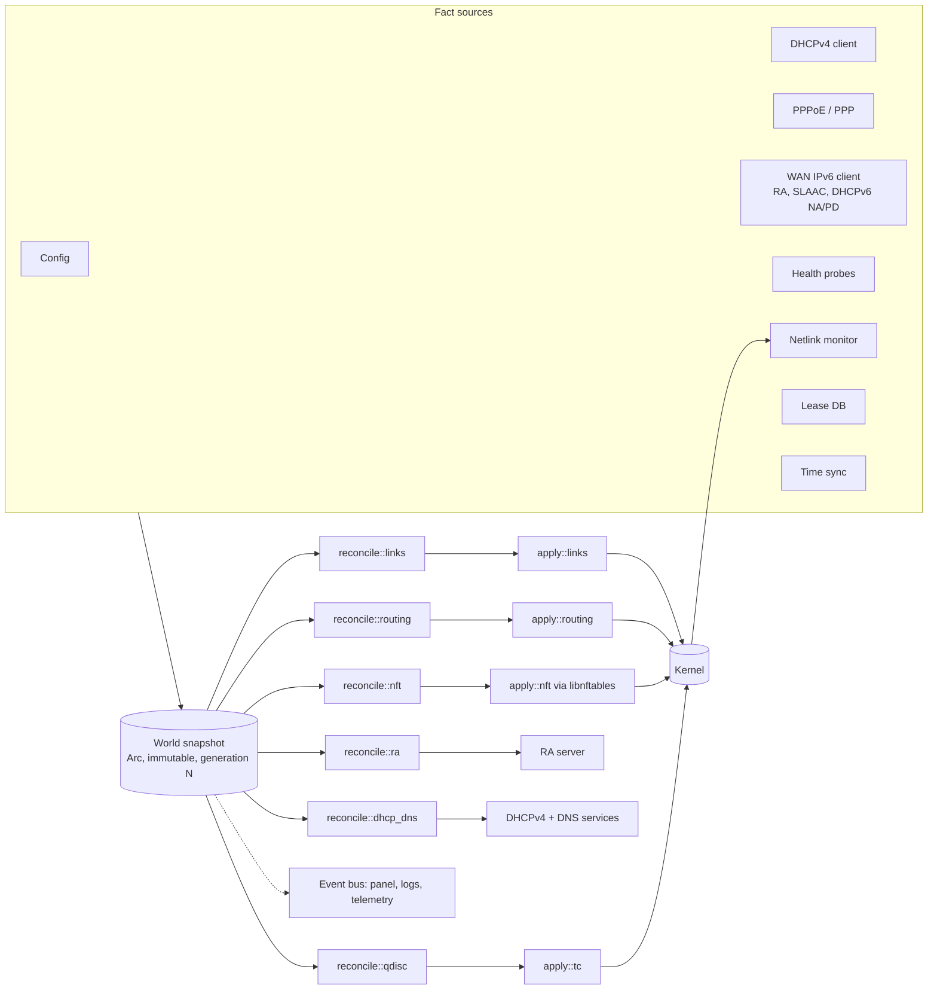

# OpenFeO — Specification

**Status:** Draft 0.3, 29 October 2026. Supersedes *OpenFeO — Design & Decisions* (29 October 2026).
**Audience:** Claude Code sessions and human contributors. This file is the source of truth. `CLAUDE.md` summarises the working rules; `docs/adr/` records every change to a decision in §2.
**Normative language:** MUST / MUST NOT / SHOULD / MAY as in RFC 2119.
**Marks:** ⚠ CONFIRM = a decision taken on recommendation that Andy has not yet signed off. Proceed on the stated default.

## 0. How to use this document

- §§1–11 define the MVP. Build only what they say. Appendix A is context for keeping interfaces compatible and MUST NOT be scaffolded or implemented until the MVP is complete.
- Work in the milestone order of §12. Each milestone has acceptance tests in the QEMU harness; a milestone is done when they pass in CI.
- Any deviation from §2 requires an ADR before code. Record protocol-level and kernel-interface discoveries (quirks, unsupported attributes, workarounds) as ADRs too.
- Prefer the simplest mechanism that satisfies a requirement. OpenFeO is a small, auditable appliance, not a framework.

## 1. What OpenFeO is

OpenFeO is a tiny Linux router: an upstream Linux kernel plus one static Rust binary, shipped as a single bootable image. The kernel does all forwarding, NAT, filtering and shaping. The Rust binary is the control plane: it is PID 1, and it configures the kernel over netlink, libnftables and syscalls.

Target users: people who want a hardened, wired home or small-office router they install and forget; fleets of edge routers and IoT gateways; virtual routers in VMs and microVMs. First dogfood deployment: Andy's AAISP FTTP line (PPPoE, DHCPv6-PD) on an x86 N100 box.

The name: FeO is iron(II) oxide, i.e. rust. `openfeo` in lowercase is used for the repository, crates, binary, kernel command-line keys and on-disk paths.

### 1.1 Goals

- **Memory-safe parsers** for everything that touches untrusted packets in userspace: DHCPv4, DHCPv6, NDP/RA, PPPoE/PPP, DNS. Every parser has a fuzz target.
- **Minimal attack surface.** No shell, no busybox, no package manager, no SSH, no stray daemons. The binary is the operating system.
- **One coherent state machine.** WAN events update routes, firewall, DHCP, DNS and router advertisements through one reconciliation loop. IPv6 prefix changes and multi-WAN failover are handled correctly by construction.
- **Immutable image, typed config, safe updates.** Reproducible builds, A/B slots with automatic rollback, commit-confirmed config, no half-applied state.
- **Testable end to end** in QEMU against a fake ISP, in CI, with deterministic protocol tests and pcap replay.
- **Light and auditable.** One readable codebase, boots in seconds, small RAM and flash footprint.

### 1.2 Non-goals

- Wi-Fi (AP mode needs hostapd; post-MVP as a sidecar, if ever).
- WireGuard — the first post-MVP feature; the data model reserves a `vpn` zone.
- LAN VLANs and multiple LAN zones — present in the data model from day one, not configurable in the MVP panel.
- UPnP/PCP, mDNS reflector, DDNS, download shaping via IFB, WAN load balancing, packages and containers, gNMI/OTLP export.
- An interactive shell or SSH of any kind (permanent).
- MIPS targets (Rust tier 3) and swconfig switches (permanent).
- A general-purpose Linux distribution: no users, no PAM, no systemd userspace, no udev.

## 2. Decisions

These are settled. Change them only with an ADR.

| Area | Decision | Rationale |
|---|---|---|
| Licence | **GPL-2.0-or-later** for all project code. No dual licensing, no CLA; contributions carry a DCO `Signed-off-by`. | libnftables is GPL-2.0-only, so the shipped binary is GPLv2: no GPL-3.0 or LGPL-3.0 crates may be linked (this excludes `rustables`). "or later" keeps future options open. ADR-0002. |
| Firewall backend | **libnftables linked in-process** (FFI, static), driven through its JSON interface. The whole ruleset is regenerated and applied as one batch. | Complete coverage (flowtables, maps, interval sets, exthdr), mature, no process spawn, atomic by construction. Config-path C fed with our own JSON, never untrusted packets. ADR-0003. |
| Boot (x86) | **systemd-boot** at the ESP fallback path with **boot assessment** (`+tries` entry names) selecting between two EFI-stub kernels (slots A/B) with the initramfs built in. Hardware watchdog armed from boot; PID 1 pets it only while the router process reports healthy. | Works on firmware that mishandles `BootNext`/`BootOrder`; rollback needs no NVRAM writes; a hang or crash loop reboots into the last good slot. ADR-0004. |
| Storage layout (x86) | GPT: ESP (FAT32, 512 MiB) holding systemd-boot, entries and both slots; `openfeo-state` (ext4, 1 GiB) for config, leases, keys and persisted logs; remainder unallocated. No root filesystem partitions: the initramfs is the OS. | Update = write one file. Installer, updater and rescue share one layout. |
| Process model | The binary re-executes itself: PID 1 is a tiny supervisor (mounts, reaping, watchdog, child restart); all router logic runs in the child. Mode comes from `openfeo.mode=` on the kernel command line or `--mode`: `metal`, `vm`, `container`, `installer`, `rescue`. | A panic in PID 1 panics the kernel. Virtual and container modes exist from the first commit. |
| Interface identity | Physical ports are identified by **bus path first** (PCI path on x86, device-tree port label on DSA boards), MAC as tiebreaker only. Ports are renamed `p0…pN` in path order; logical names (`wan0`, `lan0`) live in config. | WAN MAC cloning is a standard feature and breaks MAC-first identity. |
| LAN model | A LAN is a **bridge** of one or more ports (software bridge on x86, DSA-offloaded on switch boards), with VLAN filtering enabled and reserved for later LAN VLANs. | Any multi-port box needs it; DSA ports only switch in hardware when bridged. |
| Multi-WAN IPv6 | **Source-based routing always** (one `ip -6 rule from <prefix>` per delegated prefix), prefix **deprecation on failover**, and an `unreachable` default in a down WAN's table. NPTv6 is not used. | BCP38 at the ISP and RFC 4862's two-hour floor make source routing mandatory whichever renumbering strategy is used. |
| Multi-WAN IPv4 | One routing table per WAN, flows tagged with a per-WAN **conntrack mark**, main-table default route follows the active WAN, probes bound to their WAN. | Selective conntrack flush on failover; sticky flows for load balancing later. |
| Config | Protobuf schema is the single source of truth; **TOML** on disk using proto field names; `config_version` with forward migrations; **commit-confirmed** apply with a 60 s default; a pending config never survives a reboot. | Panel, API, CLI and file share one type system. |
| Build | `x86_64-unknown-linux-musl` (and `aarch64-unknown-linux-musl`) static binary, mimalloc, Rust stable, edition 2024. `cargo-deny` in CI. **No shelling out**: everything via netlink, libnftables FFI or syscalls. | musl's allocator is slow under async load. |
| Async runtime | tokio. State via `watch`, events via `broadcast`, commands via `mpsc`. | Ecosystem fit: rtnetlink, tonic, hyper. |
| API and panel | One set of `.proto` files; Rust via `prost` plus `pbjson` for the canonical JSON mapping, TypeScript via `protobuf-es`. Vue panel embedded in the binary, served over HTTPS; protobuf over a WebSocket envelope; gRPC multiplexed on the same port by content type. | Router and dashboard cannot drift. |
| Admin auth | Argon2id password hashes (OWASP parameters), bearer tokens (never cookies), `Origin` checked on WebSocket upgrade, self-signed TLS generated on first boot with the fingerprint shown on the console. | Defeats cross-site WebSocket hijacking and DNS rebinding on a LAN without public DNS. |
| Updates | Images and manifests signed with Ed25519 (minisign format); public keys embedded; A/B with automatic rollback via boot assessment plus the health protocol in §5.3. | Without this, bugs brick routers. |
| Kernel | **Monolithic, no modules, no firmware loading** in the MVP. Current LTS upstream kernel with our own minimal config for x86; OpenWrt's build system as kernel and image factory for ARM boards. A required-options fragment is checked in and verified at boot via `/proc/config.gz`. | Two kernel sources must not drift. |
| Hardware order | x86 N100 with Intel i226-V (first), MikroTik RB5009 (second), MediaTek Filogic class ARM64 (later). QEMU/virtio throughout. | §4. |
| Web UI framework | Vue 3 + TypeScript. | Existing skill set; bundle size is irrelevant when served on the LAN. |
| Copyright notice | `Copyright (C) 2026 Andrew Newton` in every source file. | Only a notice under pure GPL, but it must be consistent. ADR-0005. |

## 3. Prior art

Nothing found as of October 2026 is a single static Rust PID 1 doing PPPoE, DHCPv6-PD, a LAN DHCP server and DNS from an initramfs. Closest projects and what to take from them:

| Project | Language | What it is | Take from it |
|---|---|---|---|
| router7 (rtr7) | Go | Home router on gokrazy; DHCPv4/v6, DNS and RA as small binaries; DHCP ISP only, no PPPoE | Facts-published / netconfigd-applies architecture; packet ring buffer streamable to Wireshark; safe updates with backups |
| rsdsl (GitHub org: `netlinkd`, `pppoe`, `ip_config`, …) | Rust | Multi-daemon Rust xDSL router stack with its own PPPoE/PPP implementation | Read their PPP state machines before writing ours; if GPL-compatible, code MAY be reused with attribution |
| odhcp6c (OpenWrt) | C | Combined RA/SLAAC/DHCPv6 (IA_NA + IA_PD) WAN client | The model for our unified WAN IPv6 client (§7.3) |
| mwan3 (OpenWrt) | shell | Multi-WAN with ct marks, per-WAN tables and bound probes | The multi-WAN mechanics in §7.4 |
| mosnet | Rust | Daemon doing DHCP client, IPv6, nftables and NAT from the kernel command line, for hypervisor hosts | Confirms the Rust netlink stack is workable |
| BRatWuRsT | Buildroot/C | OpenWrt-style firmware with PPPoE, DHCPv6-PD, nftables and runit, developed entirely in QEMU with a fake-ISP VM | Copy the harness approach: real reference daemons on the ISP side |

Blueprint: router7's architecture, odhcp6c's WAN IPv6 model, mwan3's multi-WAN mechanics, BRatWuRsT's harness.

## 4. Targets, kernel and image

### 4.1 Targets

| Target | Role | Notes |
|---|---|---|
| x86 N100 mini PC, Intel i226-V 2.5G (`igc`) | First real target and dogfood box | UEFI, RTC, USB-stick install, CPU headroom for CAKE above 1 Gbit/s. Many such boxes ship Realtek RTL8125 (`r8169`) instead or as well: build both in. |
| QEMU/KVM, virtio-net, virtio-blk, i6300esb watchdog | Development harness and virtual product | Same image. Firecracker and Cloud Hypervisor boot the kernel directly. |
| MikroTik RB5009 (mvebu, aarch64, 1 GiB NAND) | Second target, milestone M7 | OpenWrt kernel; DSA switch; netbootable without touching RouterOS; boot and update strategy decided in an M7 ADR (RouterBOOT, NAND, UBIFS). CAKE likely limited to about 1 Gbit/s. |
| MediaTek Filogic class ARM64 | Later | Hardware flow offload via nftables flowtables, same OpenWrt template. |

### 4.2 Kernel policy

- One required-options fragment, `kernel/required.config`, applies to every target. At boot the binary reads `/proc/config.gz` (`CONFIG_IKCONFIG_PROC`) and refuses to start router services on a kernel missing a required option, logging exactly which.
- x86: upstream LTS kernel with `kernel/x86_64.config`, a minimal config written from scratch (no distro defconfig). ARM boards: OpenWrt's build system with the target's packages stripped and `CONFIG_EXTERNAL_CPIO` pointing at our initramfs; the per-target OpenWrt kernel config is overlaid with `required.config` and every needed module is forced built-in.
- The initramfs contains `/init` (the binary) and empty mount points (`/dev`, `/proc`, `/sys`, `/run`, `/state`, `/boot`, `/tmp`). Nothing else: TLS roots, the panel and all assets are compiled into the binary.
- Required options (non-exhaustive; the file is authoritative): `EFI_STUB`, `EFIVAR_FS`, `BLK_DEV_INITRD`, `INITRAMFS_SOURCE` (built in), `DEVTMPFS` + `DEVTMPFS_MOUNT`, `EXT4_FS`, `VFAT_FS`, `IKCONFIG` + `IKCONFIG_PROC`, `PSTORE` with `EFI_VARS_PSTORE` (x86) or `PSTORE_RAM` (ARM), `WATCHDOG`, `ITCO_WDT`, `I6300ESB_WDT`, `WATCHDOG_HANDLE_BOOT_ENABLED`, `WATCHDOG_NOWAYOUT`; `PACKET`, `UNIX`, `INET`, `IPV6`, `IP_MULTIPLE_TABLES`, `IPV6_MULTIPLE_TABLES`, `IPV6_SUBTREES`, `IP_ADVANCED_ROUTER`, `BRIDGE`, `BRIDGE_VLAN_FILTERING`, `VLAN_8021Q`, `PPP`, `PPPOE`, `NET_DSA` (ARM boards); `NETFILTER`, `NETFILTER_NETLINK`, `NF_CONNTRACK` + `NF_CONNTRACK_EVENTS`, `NF_CT_NETLINK`, `NF_TABLES`, `NF_TABLES_INET`, `NFT_CT`, `NFT_NAT`, `NFT_MASQ`, `NFT_REDIR`, `NFT_FIB_INET`, `NFT_FLOW_OFFLOAD`, `NF_FLOW_TABLE` + `NF_FLOW_TABLE_INET`, `NFT_REJECT` + `NFT_REJECT_INET`, `NFT_LOG`, `NFT_LIMIT`, `NFT_QUOTA`, `NFT_HASH`, `NFT_NUMGEN`, `NF_NAT`, `NF_NAT_MASQUERADE`; `NET_SCHED`, `NET_SCH_CAKE`, `NET_SCH_FQ_CODEL`, `DEFAULT_FQ_CODEL`; `IGC`, `R8169`, `IGB`, `E1000E`, `VIRTIO_NET`, `VIRTIO_PCI`, `VIRTIO_BLK`; `RTC_CLASS`, `RTC_DRV_CMOS`, `RTC_HCTOSYS`; `CGROUPS`, `NAMESPACES`, `SECCOMP` + `SECCOMP_FILTER`, `SECURITY_LANDLOCK` (post-MVP sidecars; cheap to keep). `MODULES` MUST be unset. Symbols that have since left the kernel (`NFT_COUNTER`, `RANDOM_TRUST_CPU`) and the gates the fragments need are recorded in ADR-0008.
- The kernel command line lives in the ESP boot entry, not in the kernel image: `console=ttyS0,115200 console=tty0 openfeo.mode=metal openfeo.slot=a panic=10 printk.devkmsg=on`.

### 4.3 Flash and memory

- A/B doubles flash needs: two kernel images (roughly 10–20 MiB each compressed, panel included) plus state. Floor: 64 MiB NOR/NAND or any eMMC/SSD. 16 MiB devices are out of scope.
- RAM: boots and routes in 64 MiB (VM); 1 GiB or more on real boxes. Conntrack table and DNS cache sizes scale with RAM (§7.5, §7.7).

## 5. Boot, storage, update and recovery (x86)

### 5.1 Boot chain

1. Firmware boots `\EFI\BOOT\BOOTX64.EFI`, which is systemd-boot installed at the removable-media fallback path, so no NVRAM boot entries are required (an `efibootmgr`-style entry is a nicety, never a dependency).
2. `loader/loader.conf`: `timeout 0`, `console-mode keep`, `editor no`.
3. Type #1 entries in `loader/entries/`, one per slot, e.g. `openfeo-b+3.conf`:

   ```
   title    OpenFeO 0.4.1 (slot B)
   sort-key openfeo
   version  0.4.1
   linux    /EFI/openfeo/slot-b.efi
   options  console=ttyS0,115200 console=tty0 openfeo.mode=metal openfeo.slot=b panic=10 printk.devkmsg=on
   ```

   systemd-boot sorts entries by `version` descending, so the newer slot is tried first and the older slot is the automatic fallback.
4. Boot assessment: `+3` means three tries left. systemd-boot renames `+3` → `+2-1` → `+1-2` → `+0-3`; an entry at `+0-N` is bad and is skipped. OpenFeO marks a slot good by renaming its entry to drop the suffix (`openfeo-b.conf`). The `LoaderBootCountPath` EFI variable tells the binary which entry file was counted this boot.
5. Each slot is one EFI-stub `bzImage` with the initramfs built in and nothing else. No sd-stub, no ukify.

### 5.2 Storage

| Mount | Device | Contents |
|---|---|---|
| `/boot` (mounted read-write only while updating or blessing) | ESP, FAT32 | systemd-boot, `loader/`, `EFI/openfeo/slot-{a,b}.efi`, update staging |
| `/state` | `openfeo-state`, ext4, `noatime,nodev,nosuid,noexec` | `config.toml`, `config.pending.toml`, `config.toml.bak.<version>`, `identity/` (DUID, IAIDs, DHCPv4 client-id, ULA prefix, port map), `leases/`, `tls/` (key, cert), `log/` (ring persisted at shutdown), `update/` (last manifest, health record), `boot-attempts` |
| `/run` | tmpfs | sockets, live state |

Every write of durable state MUST be temp-file + `fsync` + `rename` + directory `fsync`. Lease-database writes are debounced to at most once per 5 s. Files are mode 0600.

### 5.3 Health protocol and rollback

- PID 1 opens `/dev/watchdog0` immediately, sets the timeout to 60 s (clamped to the driver maximum), and from then on pets it **only** when it has received a heartbeat from the child within the last 20 s. The child heartbeats every 5 s while its internal checks pass (supervised tasks alive, no applier wedged for more than 30 s). Where no watchdog device exists (some VMs) PID 1 reboots itself in place of the watchdog.
- If the child exits, PID 1 restarts it with backoff; after 3 restarts within 10 minutes PID 1 stops petting, the watchdog reboots the box, systemd-boot decrements the entry counter, and after three failed boots the other slot boots.
- A slot is **blessed** (its entry renamed) when all of the following have held for `updates.confirm_after_secs` (default 300) since boot: the child has not restarted, the nft ruleset is applied, LAN services (DHCPv4, DNS, HTTPS) are listening, and, if `updates.require_wan` (default true), at least one WAN has reached `up` since boot. If the criteria are not met within `updates.confirm_timeout_secs` (default 900) on an unblessed boot, the binary reboots itself so the counter decrements promptly.
- An already blessed slot is never unblessed by runtime failures. If a blessed slot fails to reach health on three consecutive boots (tracked in `/state/boot-attempts`) and the other slot holds an older blessed image, PID 1 SHOULD give the other slot's entry `+3` and reboot into it.

### 5.4 Update flow

1. Fetch the channel manifest over HTTPS (rustls, embedded roots; waits for `time.synced`). The manifest is minisign-signed and lists version, per-target image URL, SHA-256, size, minimum `config_version`, and optionally the next signing key signed by the current one.
2. Download the image to `/boot/EFI/openfeo/staging.efi` (or `/state/update/` if the ESP is short), verify SHA-256 and the image signature, then `rename` it over the **inactive** slot. The running slot is never written.
3. Write the inactive slot's entry as `openfeo-<slot>+3.conf` with the new `version`, `fsync`, and reboot (or defer to a maintenance window per config).
4. Rollback is §5.3. The config file is backed up before any migration; a downgraded image refuses a config newer than it understands and says so on the console and in the panel.

### 5.5 Commit-confirmed configuration

- `ApplyConfig` writes `config.pending.toml`, applies it, and starts a timer (default 60 s). `ConfirmConfig` promotes pending to `config.toml`; timer expiry or `RevertConfig` republishes the previous config and deletes the pending file.
- At boot a pending file is deleted and never applied; an event records that an unconfirmed change was discarded.
- Reverting is republishing the previous `Config` snapshot through the normal loop. There are no special revert code paths.

### 5.6 Recovery without a shell

- **Console menu** on serial/HDMI, offered for 3 s at boot when a key is pressed and whenever the previous boot did not reach health: reboot into the other slot, reset admin password, reset config to defaults, export support bundle to USB, show TLS fingerprint and port map. Numbered choices only; no free-form input beyond a new password.
- **Triple power-cycle**: if three consecutive boots are cut short within 30 s of start (tracked in `/state/boot-attempts`), the next boot opens the console menu and enables a temporary password-less panel on the LAN for 10 minutes, announcing it on the console.
- **USB installer in rescue mode** can do everything the console menu can, plus reinstall a slot and read or write `/state`.
- **First-boot wizard** (panel): maps ports to roles using link-up detection ("plug the ISP cable in now"), sets the admin password, shows the TLS fingerprint, picks WAN type and LAN subnet, and applies with commit-confirm. Until the wizard completes, all ports form one temporary LAN (192.168.1.1/24, DHCP on) and nothing is forwarded.

## 6. Process model and control plane

### 6.1 PID 1

Mounts `proc`, `sysfs`, `devtmpfs`, `tmpfs` on `/run`, `cgroup2`, `efivarfs` and `pstore`; mounts `/state` (creating the filesystem in `installer` mode only); sets hostname and loopback; opens the watchdog; writes core sysctls; then forks and execs itself as the router child with the same mode and supervises it (§5.3). It handles `SIGCHLD` (reap), `SIGTERM`/`SIGINT` (container-mode shutdown) and `reboot(2)` requests from the child over the control pipe. It links no async runtime: a few hundred lines of blocking code with `unsafe` confined to one `sys` module.

### 6.2 Reconciliation model

Desired-state reconciliation, not event chains.



1. Fact sources publish their latest state on `watch` channels.
2. Any change produces a new immutable `Arc<World>`: config plus all facts plus a monotonic generation number.
3. Reconcilers are **pure functions** `fn(&World) -> Desired`, one per subsystem: links and bridges; addresses, routes and rules; the nftables ruleset (as JSON); qdiscs; RA contents; DHCP-server and DNS settings. They are unit-tested without root or a kernel, with `insta` snapshots.
4. Appliers diff desired against observed state and make the kernel match. Observed state for links, addresses, routes and rules comes from the netlink monitor's cache, never from a one-off dump, so an applier never races its own events.

Rules:

- Appliers own only what they tag. Routes and rules carry `RTPROT_OPENFEO = 200`; nft lives in `table inet openfeo`; appliers track the addresses and qdiscs they added. Kernel-originated state (link-local addresses, connected routes, anything on interfaces we do not manage) is never deleted.
- An apply failure MUST NOT terminate a reconciler task. The applier retries with capped exponential backoff, publishes a `degraded` health fact naming the subsystem and error, and the next World generation retries immediately.
- `watch` coalesces bursts: a slow reconciler sees only the latest World.

```rust
loop {
    let world = world_rx.borrow_and_update().clone();      // Arc<World>
    let desired = reconcile::nft::ruleset(&world);          // pure
    if desired != applied {
        match applier.apply(&desired).await {
            Ok(()) => { applied = desired; health.ok(Subsystem::Nft); }
            Err(e) => { health.degraded(Subsystem::Nft, &e); backoff.sleep().await; continue; }
        }
    }
    world_rx.changed().await?; // Err only when the runtime is shutting down
}
```

### 6.3 Concurrency building blocks

- Actors are plain tokio tasks (Alice Ryhl's pattern) under a small in-house supervisor that restarts crashed tasks with backoff and counts restarts into the health fact. No actor framework.
- `watch` for state, `broadcast` for the event bus (outside the control loop: panel pushes, logs, telemetry), `mpsc` for commands.
- **Sans-IO protocol cores**: DHCPv4, DHCPv6, NDP/RA, PPPoE discovery and each PPP control protocol are enum state machines with `fn handle(&mut self, Input) -> Vec<Output>`, where `Input` is a packet, a timer expiry or a command and `Output` is a packet to send, a fact to publish or a timer to arm. No sockets, no clocks, no async inside. Drivers in `openfeo-net` own the sockets and timers. `statig` MAY be used where a machine is hierarchical (PPP's LCP → auth → NCP phases).
- Deterministic tests use `tokio::time::pause` plus recorded or synthesised packets; `turmoil` MAY be used for multi-node simulation.

## 7. Networking semantics

What the reconcilers and protocol cores must do. Kernel names: physical ports `p0…pN`; VLAN sub-interfaces `p1.101`; bridges `br-<lan>`; PPP interfaces `ppp-<wan>`. Logical names (`wan0`, `lan0`) exist only in config, facts and the UI.

### 7.1 Ports, identity and roles

- At boot the binary enumerates netdevs, computes each port's stable identity (`/sys/class/net/*/device` PCI path on x86; DSA port label from the device tree), sorts, renames to `p0…pN` while the interfaces are still down, and compares with `identity/portmap`. A new or missing port is reported on the console and in the panel; roles are never guessed.
- Config maps roles to ports: a WAN is one port, optionally with an 802.1Q VLAN ID and a cloned MAC; a LAN is a set of ports bridged as `br-<lan>` (bridge MAC = lowest member MAC, `vlan_filtering` on, default PVID 1, STP off by default).
- Link state, speed and duplex are facts from the netlink monitor; they feed the panel and WAN health.

### 7.2 WAN types (IPv4)

**DHCPv4 client** (wire format shared with the server): AF_PACKET in INIT/SELECTING, UDP with `SO_BINDTODEVICE` once bound; persisted client-id (`identity/`); INIT-REBOOT with the last lease after a reboot; options requested: subnet mask, router, DNS, domain name, broadcast, MTU, classless static routes (121, plus 249 for compatibility), NTP, renewal and rebind times; honours T1/T2 and lease expiry; publishes address, gateway, DNS servers, static routes and MTU as facts. Vendor class and hostname options are configurable.

**Static**: address, gateway, DNS from config.

**PPPoE** — a full PPP client:

- *Discovery* over AF_PACKET (`ETH_P_PPP_DISC`): PADI/PADO/PADR/PADS/PADT; optional service-name and AC-name filters; Host-Uniq; **RFC 4638 PPP-Max-Payload** requesting 1500 (AAISP supports it), falling back to 1492.
- *Kernel plumbing*: `socket(AF_PPPOX, SOCK_STREAM, PX_PROTO_OE)` + `connect(sockaddr_pppox{session, remote MAC, device})`; `open("/dev/ppp")` → `PPPIOCNEWUNIT`; a second `/dev/ppp` fd for the channel: `PPPIOCGCHAN` on the PPPoX socket, `PPPIOCATTCHAN`, `PPPIOCCONNECT` to the unit; MRU via `PPPIOCSMRU`, MTU via netlink. Control protocols (LCP, PAP/CHAP, IPCP, IPV6CP) are read and written as frames on the channel fd; IP and IPv6 flow through the `ppp-<wan>` netdev in kernel.
- *LCP*: MRU, magic number, authentication-protocol negotiation, echo request/reply keepalive (default 10 s interval, 3 failures), terminate. *Auth*: PAP and CHAP-MD5 (MS-CHAP not in MVP). *IPCP*: address plus primary/secondary DNS options. *IPV6CP*: interface identifier, after which the binary adds `fe80::<local-iid>/64` to the interface and a route to the peer's link-local address.
- Reconnect with exponential backoff; handle AC-initiated PADT and LCP Terminate; publish session id, addresses, DNS, MTU and uptime as facts.
- MSS clamping (`tcp flags syn tcp option maxseg size set rt mtu`) is generated for any WAN whose MTU is below 1500.

**VLAN-tagged WAN**: a `p0.101`-style sub-interface under any of the above.

### 7.3 IPv6

**WAN IPv6 client** — one core per WAN in the odhcp6c mould, running on the WAN netdev (Ethernet or PPP), with kernel autoconfiguration disabled on WANs (`accept_ra=0`, `autoconf=0`; `addr_gen_mode` stable-privacy on Ethernet, the IPV6CP identifier on PPP):

- *RS/RA processing*: default router and lifetime; PIO (A flag → SLAAC address with an RFC 7217 stable IID; L flag → on-link route); MTU option; RDNSS/DNSSL; route-information options. Publishes the default router with its lifetime; the routing reconciler installs it in the WAN's table and expires it on lifetime.
- *DHCPv6*: Solicit with IA_PD (hint length configurable, default 56) and optional IA_NA; Rapid Commit; Reconfigure unsupported; options DNS servers, domain list, SOL_MAX_RT; T1/T2 renew and rebind; Confirm/Rebind after a link flap; publishes delegated prefixes with preferred and valid lifetimes, and addresses.
- *Identity*: one DUID per router (DUID-UUID, or DUID-LL from the lowest physical port MAC), generated once and persisted in `identity/`, never derived from a PPP interface; IAIDs derived deterministically from the WAN name.

**LAN IPv6**:

- Each LAN is assigned one /64 from every delegated prefix (assignment index per LAN, stable across reboots) plus one /64 from a per-router **ULA** /48 (RFC 4193, generated once, persisted). The router takes `::1` in each.
- **RA server** per LAN: a PIO per assigned prefix (A=1, L=1) with lifetimes derived from the delegation (capped), RDNSS and DNSSL pointing at the router, MTU option, O=1 and M=0, router lifetime 1800 while at least one WAN has a usable IPv6 default route and **0 when none does**, so hosts fall back to IPv4 cleanly. Unsolicited RAs on change plus the periodic interval; replies to RS.
- **Stateless DHCPv6** responder (Information-Request → DNS, domain) for clients that ignore RDNSS.
- A prefix that disappears, or whose WAN goes down, is advertised with preferred lifetime 0 and valid lifetime 7200 for two hours, then dropped. Hosts cannot shorten a valid lifetime below two hours from an unauthenticated RA (RFC 4862 §5.5.3), so this is the fastest correct deprecation.
- **Source-based routing**: for every delegated prefix, `ip -6 rule from <prefix> lookup <wan-table>`, so traffic from a prefix leaves via the WAN that delegated it. A down WAN's table gets `unreachable default`, so traffic from its deprecated prefix fails fast instead of timing out.
- ICMPv6 follows RFC 4890: NDP, MLD, PMTUD messages and rate-limited echo are allowed where required; everything else follows zone policy. IPv6 MUST NOT be broken by the default ruleset.

### 7.4 Routing and multi-WAN

- Tables: `main` (connected routes, LAN routes, the active WAN's defaults), one table per WAN (`100 + index`: that WAN's connected and default routes, IPv4 and IPv6). Rules, lowest first: `1000` fwmark `0x100 × (index + 1)` → WAN table; `2000` IPv6 source-prefix rules and IPv4 `from <WAN address>` rules; `32766` main.
- Conntrack marks: the first packet of a flow is marked after routing with its egress WAN's mark (`ct mark set meta mark`); later packets restore it (`meta mark set ct mark`), so replies and the whole flow stick to one WAN. The router's own bound sockets use `SO_MARK` to select a WAN.
- Health probes per WAN: ICMP echo and/or DNS queries to configurable targets, sockets bound with `SO_BINDTODEVICE` and `SO_MARK` so they test that WAN rather than the default route; up/down thresholds and interval configurable; a WAN with link down is down immediately.
- Failover: the highest-priority `up` WAN is active. On change: main default routes (v4 and v6) are swapped, conntrack entries carrying the dead WAN's mark are deleted via ctnetlink (mark-filtered flush), RA and DNS upstreams are reconciled, an event is emitted. Fail-back is immediate when a higher-priority WAN returns, subject to a configurable hold-down.
- Reverse-path filtering in nft, not sysctl: strict on LAN zones (`fib saddr . iif oif missing drop`), loose on WAN zones (`fib saddr oif missing drop`). Kernel `rp_filter` stays 0.

### 7.5 Firewall and NAT

- Zones: one per WAN, one per LAN, `router` (local input/output), and a reserved `vpn`. Policies form a zone-pair matrix: LAN→WAN accept; WAN→LAN drop; LAN↔LAN per config (default accept within a LAN, drop between LANs); WAN→router drop except the DHCPv6 client (UDP 546), ICMPv6 per §7.3 and optional ping; LAN→router: DHCP, DNS, HTTPS, NTP, ICMP.
- The ruleset is one `table inet openfeo` regenerated from the World and applied as a single libnftables batch: `add table inet openfeo; delete table inet openfeo;` followed by the full definition in the same buffer (the add/delete pair makes the replace idempotent and the batch makes it atomic). Named sets and maps hold port-forward targets, blocklists and WAN address sets; rule counts never grow with list sizes.
- NAT: IPv4 masquerade per WAN; port forwards as `dnat` maps with **hairpin** (LAN clients reaching a forwarded port via the WAN address are DNATed and SNATed to the router); no IPv6 NAT.
- Flowtable `ft` over the physical LAN and WAN ports with software offload for established flows (kernel ≥ 5.13 handles PPPoE and VLAN encapsulation); verified in the harness. Hardware offload is a per-WAN choice that disables CAKE on that WAN.
- Logging rules use `log` with `limit`; the binary reads `/dev/kmsg` into the log ring, so firewall logs appear in the panel.
- Conntrack sizing: `nf_conntrack_max` from RAM (16k per 64 MiB, capped), hashsize accordingly; default timeouts.

### 7.6 DHCPv4 server

Per LAN: pool range, lease time, static leases (by MAC, optionally client-id) with hostnames, options router/DNS/domain (`home.arpa` default)/NTP (optional), classless routes optional; DHCPINFORM answered; conflict detection by ARP probe before offer (SHOULD); lease DB persisted (§5.2) and published as facts for DNS and the panel; hostnames sanitised to DNS labels.

### 7.7 DNS forwarder

- Listens on every LAN address (v4 and v6), UDP and TCP 53; caches by TTL with negative caching (RFC 2308); EDNS0 with a 1232-byte UDP buffer; truncation → TCP retry; no recursion; DNSSEC bits passed through, no validation in MVP. Cache size scales with RAM.
- Upstreams: learned per WAN (IPCP, DHCPv4, RDNSS, DHCPv6) for the active WAN, or user-configured; DNS-over-TLS upstreams SHOULD be supported since rustls is already linked.
- Local zone: `<hostname>.<domain>` A records from leases, PTR reverse zones for LAN subnets, the router's own name; static leases resolve even before they are active.
- **Rebinding protection**: upstream answers containing RFC 1918, link-local, ULA, loopback or the router's own addresses are dropped unless the name is on a configured allow-list.
- Blocklists (the Rustik Block design) slot in as named sets consulted before forwarding, answering NXDOMAIN or `0.0.0.0`/`::`.
- Implementation MAY use `hickory-proto` for wire format or an in-tree parser; either way the parser has a fuzz target.

### 7.8 Shaping (CAKE)

Per WAN, egress only in the MVP: a `cake` root qdisc on the WAN's egress netdev (`ppp-<wan>`, `pN.vid` or `pN`) with `bandwidth`, `overhead`/`mpu` derived from a link preset (`ethernet`, `vdsl-ptm`, `docsis`, `custom`) to which the generator adds 8 bytes for PPPoE and 4 per VLAN tag, plus `nat`, `wash`, `diffserv3`, `triple-isolate`, optional `ack-filter`, `split-gso` on. Attributes are encoded from `include/uapi/linux/pkt_sched.h` (`TCA_CAKE_*`) on top of `netlink-packet-route`; qdisc statistics are read on a timer for the panel. Download shaping via IFB is post-MVP; the data model carries both directions now.

### 7.9 Performance levers the binary sets

Flowtable software offload (§7.5); IRQ affinity spreading NIC queues across cores (`/proc/irq/*/smp_affinity`) and RPS/XPS via sysfs; NIC ring sizes via ethtool netlink; conntrack sizing; `net.core` buffer sizes; `tcp_mtu_probing` on. Throughput is a kernel/NIC/CPU property; CAKE caps a WAN at roughly one core.

### 7.10 Time

SNTP client (RFC 4330) to configured servers (default `pool.ntp.org` names resolved through the forwarder) over the active WAN; steps once at boot, then slews; refuses to set a time earlier than the build timestamp; on boards without an RTC the build timestamp is the floor until sync. TLS verification and updates wait for `time.synced`.

## 8. API, configuration and web panel

### 8.1 Schema

- `proto/openfeo/v1/*.proto` is the single source of truth: `config.proto` (the whole config), `state.proto` (live facts and counters), `events.proto`, `api.proto` (services). `buf lint` and `buf breaking` run in CI; field numbers are never reused, removed fields are `reserved`, `optional` is used wherever unset differs from zero.
- Rust: `prost` + `pbjson` (canonical JSON mapping) generated in `build.rs`. TypeScript: `protobuf-es` via `buf generate` into `web/src/gen/`.
- Semantic validation (CIDRs, overlaps, port ranges, unique names, pool inside subnet, role/port consistency) lives in `openfeo-config::validate` and is used by file load, `ApplyConfig` and the panel's preview. Errors are structured (`path`, `code`, `message`). Protobuf types alone do not validate anything.

### 8.2 Config file

`/state/config.toml`, keyed by proto field names (snake_case), parsed through `pbjson` into the `Config` type. `config_version` is a top-level integer; `migrate(n → n+1)` functions run at load and the original is kept as `config.toml.bak.<n>`. Secrets (PPPoE password, admin hash) live in the same file at mode 0600. Shape:

```toml
config_version = 1

[system]
hostname = "openfeo"
domain = "home.arpa"
timezone = "Europe/London"
ntp_servers = ["0.pool.ntp.org", "1.pool.ntp.org"]

[admin]
password_hash = "$argon2id$..."

[[ports]]                  # identity -> kernel name
id = "pci-0000:02:00.0"
name = "p0"

[[wans]]
name = "wan0"
port = "p0"
vlan = 0                   # 0 = untagged
kind = "pppoe"             # dhcp | static | pppoe
priority = 10
[wans.pppoe]
username = "..."
password = "..."
[wans.ipv6]
mode = "auto"              # auto | disabled
pd_hint = 48
[wans.probe]
targets = ["1.1.1.1", "9.9.9.9"]
interval_secs = 5
[wans.shaping]
upload_kbit = 110000
link = "ethernet"          # ethernet | vdsl-ptm | docsis | custom; PPPoE/VLAN overhead added automatically

[[lans]]
name = "lan0"
ports = ["p1", "p2", "p3"]
ipv4 = "192.168.1.1/24"
[lans.dhcp]
range = ["192.168.1.100", "192.168.1.250"]
lease_secs = 43200
[[lans.dhcp.static]]
mac = "aa:bb:cc:dd:ee:ff"
ip = "192.168.1.10"
hostname = "nas"

[firewall]
# zone policies, port forwards, rules

[dns]
upstreams = []             # empty = learned from the active WAN
blocklists = []

[updates]
channel = "stable"
auto = true
confirm_after_secs = 300
```

### 8.3 Transport

- One HTTPS listener (default 443, LAN addresses only): panel assets, `POST /api/login`, `GET /ws` (binary WebSocket), gRPC multiplexed by `content-type: application/grpc` for CLI, scripts and fleet tooling, and `?format=json` on the HTTP mirrors of read-only calls for debugging via the canonical JSON mapping. Port 80 redirects to HTTPS.
- WebSocket envelope:

  ```proto
  message ClientMsg {
    uint32 id = 1;
    oneof body { Auth auth = 2; Subscribe subscribe = 3; Unsubscribe unsubscribe = 4; Request request = 5; }
  }
  message ServerMsg {
    uint32 id = 1;  // 0 = unsolicited push
    oneof body { Response response = 2; Event event = 3; Telemetry telemetry = 4; Error error = 5; }
  }
  ```

  The first client frame MUST be `Auth{token}` within 5 s or the socket is closed. Subscriptions are per topic (interface counters, qdisc stats, WAN state, leases, log tail, capture stream); telemetry is coalesced per subscription so a slow browser only ever receives the latest snapshot.
- Services (gRPC and WS `Request` share message types): `Auth` (Login, Logout, ChangePassword); `Config` (Get, Validate, Apply{commit_confirm, timeout}, Confirm, Revert, Backup{passphrase}, Restore); `State` (Get, Subscribe); `Diagnostics` (Ping, Traceroute, CaptureStart/Stop, DumpRoutes, DumpNeigh, DumpConntrack, DumpRuleset, SupportBundle); `System` (Reboot, CheckUpdate, InstallUpdate, FactoryReset, Logs).

### 8.4 Panel

Vue 3 + TypeScript, built with Vite, embedded into the binary at build time. Pages: first-boot wizard; dashboard (per-WAN state, throughput, CAKE stats); ports and roles; WANs; LANs and DHCP (leases, static leases); firewall (zone matrix, port forwards, rules); DNS (upstreams, blocklists, local names); shaping; system (updates, backup/restore, password, time, reboot); logs; diagnostics. Every config change goes validate → apply with commit-confirm → confirm. The token is held in memory or `sessionStorage`, never a cookie.

## 9. Security requirements

- No shell, no SSH, no debug listeners, no telnet, no serial login. The console menu is the only local interface and has no free-form command input.
- Admin password: Argon2id with OWASP-recommended parameters; login rate-limited per source address with exponential backoff; tokens are 256-bit random, stored hashed, expire after inactivity; `ChangePassword` revokes other sessions.
- TLS: rustls only; ECDSA P-256 self-signed certificate and key generated at first boot (`rcgen`), persisted in `/state/tls`, fingerprint shown on the console and in the panel; regenerated when the hostname changes. ACME DNS-01 is post-MVP.
- Web: `Origin` on the WebSocket upgrade MUST match the router's own names and addresses; `Host` header validated; strict CSP; `X-Frame-Options: DENY`; no CORS allow-list; the panel is served only on LAN zones unless explicitly enabled per WAN.
- DNS rebinding protection as in §7.7.
- Default firewall: deny inbound on WAN, with IPv6 exactly as safe as IPv4.
- Updates: manifest and image signatures verified before anything is written; a verification failure is an event, never a silent retry loop.
- Backups are encrypted (Argon2id-derived key, XChaCha20-Poly1305, or `age`); the export dialog refuses an empty passphrase.
- Secrets are never logged; the support bundle redacts them.
- Memory safety: `#![forbid(unsafe_code)]` in every crate except `openfeo-init` and `openfeo-nft`, where `unsafe` is confined to small modules with `// SAFETY:` comments; every parser is fuzzed in CI.

## 10. Observability and diagnostics

- Logging through `tracing`: structured events into an in-memory ring (default 8 MiB) exposed over the API with level filters, also written to `/dev/kmsg` so the serial console shows them; the ring is persisted to `/state/log` at clean shutdown; kernel panics are captured via pstore and attached to the next support bundle. Remote syslog and OTLP are post-MVP.
- Telemetry: interface counters, qdisc statistics, conntrack count, CPU/memory/temperature, WAN RTT from probes, read from netlink and sysfs on a timer. Never per packet in userspace.
- Event-bus topics (stable names, used by the panel and later by packages): `wan.{name}.{up|down|addr|prefix}`, `lan.{name}.lease.{granted|released}`, `config.{applied|confirmed|reverted}`, `update.{available|installed|rolled_back}`, `health.{ok|degraded}`.
- Diagnostics (panel and API): ping/traceroute from the router bound to a chosen WAN; **packet capture** on any interface (AF_PACKET `TPACKET_V3` ring, snaplen and rate caps, simple host/port filters) streamed as pcapng over the WebSocket and downloadable; dumps of routes, rules, neighbours, conntrack and the live ruleset (`list ruleset` through libnftables JSON); support bundle = config (redacted), identity, dumps, logs, pstore, versions, port map.

## 11. Test strategy

- **Unit**: sans-IO cores against synthesised and recorded packets (`tests/fixtures/*.pcap`; no credentials committed); property tests (`proptest`) on parsers; reconcilers against World fixtures with `insta` snapshots of desired state (ruleset JSON, route sets, RA contents).
- **Fuzzing**: `cargo fuzz` targets for every parser (DHCPv4, DHCPv6, ND/RA, PPPoE, LCP/IPCP/IPV6CP/PAP/CHAP, DNS, config TOML), run in a nightly CI job with a checked-in corpus.
- **Harness** (`harness/`): the router runs in QEMU (KVM when the runner has it, TCG otherwise; i6300esb watchdog; virtio-net ports `p0` = WAN A, `p1` = WAN B, `p2` = LAN) attached through tap devices to network namespaces on the CI host. ISP namespaces run **reference daemons**: Kea (DHCPv4; DHCPv6 IA_NA and IA_PD), radvd, `pppoe-server` + pppd (PAP/CHAP, IPCP, IPV6CP, RFC 4638) with odhcpd or Kea for PD over PPP, plus HTTP and DNS targets. The LAN namespace runs a Rust test client (DHCPv4, SLAAC/DHCPv6, DNS, HTTP). Scenarios: link flap, lease expiry, prefix change, PADT, ISP down/up, power cut during update, broken-image rollback.
- **Panel**: Playwright end-to-end tests against the harness VM.
- **CI matrix**: `cargo test`, `cargo clippy -D warnings`, `cargo deny check`, `buf lint` and `buf breaking`, kernel build (cached), image build, harness scenarios for every completed milestone, nightly fuzz.

## 12. Milestones

MVP = M0–M6 green in CI plus 30 days of dogfooding on the AAISP line. A milestone may not start until the previous one is green.

| # | Scope | Acceptance (in the harness unless stated) |
|---|---|---|
| **M0 Harness and skeleton** | Workspace, CI, `required.config`, x86 kernel build, initramfs, PID 1 (mounts, watchdog, supervisor, console log), harness with one ISP namespace and a LAN namespace, `openfeo.mode=vm` | VM boots to PID 1 in CI, logs version and port map; child restart observed after kill; watchdog reboot observed when heartbeats stop |
| **M1 IPv4 router** | Port identity and roles, LAN bridge, DHCPv4 client, static WAN, World/reconcile/apply loop, netlink monitor, libnftables ruleset (zones, masquerade, port forwards, hairpin), DHCPv4 server with static leases, DNS forwarder with local names and rebinding protection, SNTP, config load/validate/migrate, kernel-option check | LAN client gets a lease, resolves `nas.home.arpa`, fetches HTTP from the ISP side through NAT; port forward reachable from WAN and via hairpin; WAN lease renews; WAN link flap recovers; a child crash does not interrupt forwarding |
| **M2 IPv6** | WAN IPv6 client (RA, SLAAC, DHCPv6 NA/PD, DUID persistence), LAN prefix assignment, ULA, RA server, stateless DHCPv6, source-based rules, ICMPv6 policy, deprecation | LAN client gets a GUA from the delegation and reaches an ISP-side v6 server; ISP changes the prefix → LAN renumbered within 10 s, old prefix deprecated, traffic from it receives ICMPv6 unreachable; WAN v6 loss → router lifetime 0 within one RA interval |
| **M3 PPPoE and VLAN WAN** | Discovery, LCP, PAP/CHAP, IPCP, IPV6CP, kernel plumbing, keepalive, reconnect, RFC 4638, MSS clamp, 802.1Q WAN | v4 and v6 over PPP against `pppoe-server`/pppd at MTU 1492 and 1500; AC-initiated PADT and LCP echo failure both recover; a wrong password backs off and is reported; prefix delegation over PPP works |
| **M4 API and panel** | Proto/pbjson/protobuf-es pipeline, HTTPS, auth, WebSocket envelope and subscriptions, gRPC, Vue panel pages, first-boot wizard, commit-confirm, logs and diagnostics views, packet capture | Playwright: wizard → routing; LAN subnet changed without confirming → reverted at 60 s; capture stream opens in Wireshark; a WS upgrade with a foreign `Origin` is refused |
| **M5 Install, update, recovery** | USB installer, GPT layout, systemd-boot and entries, signed manifest and image, A/B write and bless, health protocol, console menu, triple power-cycle, encrypted backup/restore, factory reset | Install to a virtual disk and boot; update to a deliberately broken image → three failed boots → old slot boots and reports the rollback; update to a good image → blessed after health; power cut mid-download leaves the running slot intact |
| **M6 Multi-WAN and CAKE** | Per-WAN tables, ct marks, bound probes, failover and fail-back, mark-filtered conntrack flush, IPv6 failover semantics, CAKE per WAN, flowtable, IRQ/RPS tuning | Two ISPs: kill ISP A → traffic flows via B within the configured threshold, v6 clients move to prefix B, flows with A's mark are gone; A returns → fail-back; CAKE present with the configured parameters (netlink dump) and qdisc stats visible in the panel |
| **M7 RB5009** | OpenWrt kernel factory, `EXTERNAL_CPIO`, DSA bridge, netboot workflow, NAND/UBIFS state, boot and update ADR, `aarch64-musl` build | Netboots and passes the M1–M3 scenarios on hardware (manual) |

Post-MVP order: WireGuard, download shaping (IFB), LAN VLANs in the panel, DDNS, mDNS reflector, remote syslog and OTLP, then Appendix A.

## 13. Repository, workspace and working rules

```
openfeo/
  SPEC.md  CLAUDE.md  LICENSE (GPL-2.0-or-later)  docs/adr/
  proto/openfeo/v1/            buf.yaml  buf.gen.yaml
  kernel/                      required.config  x86_64.config  build.sh  openwrt/ (per-board diffconfig)
  image/                       installer, ESP layout, systemd-boot fetch/build, signing tools
  crates/
    openfeo-init               PID 1: mounts, reaper, supervisor, watchdog, console menu (no tokio)
    openfeo-world              World, facts, health, event bus, supervisor runtime
    openfeo-proto-dhcp4        sans-IO client + server cores and wire format
    openfeo-proto-dhcp6        sans-IO client (NA/PD) + stateless server
    openfeo-proto-ndp          sans-IO RA client + RA server
    openfeo-proto-ppp          sans-IO PPPoE discovery, LCP, PAP, CHAP, IPCP, IPV6CP
    openfeo-proto-dns          wire format + cache (or hickory-proto wrapper)
    openfeo-net                socket/timer drivers for the cores, raw sockets, ppp plumbing
    openfeo-netlink            rtnetlink monitor + cache; links, bridges, addrs, routes, rules; tc (CAKE); ethtool; ctnetlink
    openfeo-nft                libnftables FFI + JSON ruleset types
    openfeo-reconcile          pure World -> Desired for every subsystem
    openfeo-apply              appliers
    openfeo-services           DHCPv4 server, DNS forwarder, SNTP, probes, RA runtime
    openfeo-config             proto types (prost/pbjson), TOML, validation, migrations
    openfeo-api                HTTPS, auth, WebSocket, gRPC, embedded panel
    openfeo-platform           slots, updates, signing, storage, backup, diagnostics, capture
    openfeo                    the binary: wiring and modes
  web/                         Vue panel
  harness/                     QEMU + netns orchestration, ISP configs, scenario tests
  fuzz/
```

Dependency rules (enforced by `cargo deny` bans and a CI script over `cargo metadata`):

- `openfeo-proto-*` and `openfeo-reconcile` MUST NOT depend on `tokio`, `libc`, `nix`, `socket2`, or anything that opens sockets or reads clocks.
- Only `openfeo-netlink`, `openfeo-nft`, `openfeo-net`, `openfeo-platform` and `openfeo-init` may call into the kernel.
- `std::process::Command` is banned everywhere except `harness/` and `image/` (clippy `disallowed_methods`).
- C code: libnftables and its dependencies (libmnl, libnftnl, jansson, mini-gmp) built statically in `openfeo-nft/build.rs`, configured `--with-json --with-mini-gmp --without-cli --without-xtables`; rustls with `ring`; no OpenSSL anywhere.

Coding rules (repeated in `CLAUDE.md`):

- Rust stable, edition 2024, `clippy -D warnings` with `pedantic` as warnings; no `unwrap`/`expect` outside tests; `thiserror` in libraries, `anyhow` only in the binary; `tracing` for logs.
- Every parser gets a fuzz target in the same PR that adds it.
- Every change to §2 gets an ADR (`docs/adr/NNNN-title.md`: context, decision, consequences). Kernel and protocol quirks discovered in the harness are recorded as ADRs too.
- Commits carry `Signed-off-by` (DCO). SPDX header `GPL-2.0-or-later` in every source file.
- Third-party notices generated by `cargo about` into the image and the panel's About page.

## 14. Licensing

- Project code: GPL-2.0-or-later. No CLA; DCO sign-off.
- Because libnftables is GPL-2.0-only, the shipped binary is a GPLv2 work: `cargo deny` MUST reject GPL-3.0*, LGPL-3.0*, AGPL-* and any licence incompatible with GPL-2.0. Allowed: MIT, Apache-2.0, BSD-2/3-Clause, ISC, MPL-2.0, Zlib, Unicode, LGPL-2.1+, GPL-2.0(-or-later), CC0, Unlicense.
- The kernel's GPLv2 does not affect a userspace binary (syscall exception); uapi headers are fine. systemd-boot (LGPL-2.1+) ships as a separate EFI binary. Harness tooling may use anything.
- Trademark, GitHub organisation and domains for "OpenFeO" to be checked (§15). Not legal advice.

## 15. Open items

- [x] Confirm §2: GPL-2.0-or-later, libnftables backend, systemd-boot + watchdog boot design, copyright-notice holder (Andrew Newton). Confirmed 29 October 2026; ADRs 0002–0005.
- [ ] GitHub organisation, domains and UK IPO trademark search for OpenFeO.
- [ ] Buy the N100 box (Intel i226-V); note whether it exposes a serial header.
- [x] Write `CLAUDE.md` and the first ADRs from §2.
- [ ] Decide release signing-key custody (offline key; CI holds only a dev key) before M5.
- [ ] M1: `hickory-proto` vs in-tree DNS parser (ADR).
- [ ] M3: record a sanitised AAISP PPPoE session pcap for fixtures (credentials stripped).
- [ ] M7: RB5009 boot/update ADR after studying OpenWrt's mvebu MikroTik sysupgrade path.
- [ ] Harness: confirm Kea or odhcpd for DHCPv6-PD over PPP.

## Appendix A — Post-MVP context (do not implement)

Kept so the MVP's interfaces stay compatible. The only MVP obligations arising from this appendix are: stable event-topic names (§10), the mode enum (§2), per-zone nft chain hook points reserved in the ruleset generator, the `vpn` zone, and config sections modelled as proto messages so later features add messages rather than restructure.

**Packages** come in three tiers on one versioned internal API: build-time crates (first-party features as Cargo features, with an online image builder emitting signed per-board images); WASM modules (`wasmi`, WIT interfaces via the component model) for sandboxed third-party logic such as DDNS providers, lease webhooks, custom DHCP options and exporters; supervised sidecars (signed static binaries on squashfs, confined with namespaces, Landlock and seccomp; OCI containers on larger hardware) for software not worth rewriting: hostapd, Tailscale, a full resolver. The shared contract: each package contributes a config schema section, subscribes to events, requests resources (its own nftables chain hooked in by the core, a port, an interface) and declares capabilities in a manifest that the core enforces.

**Containers** are kernel primitives the binary drives directly: namespaces, cgroups v2 (device control via eBPF), seccomp-bpf, Landlock, capability dropping, `pivot_root` with overlayfs or squashfs, veth or macvlan over netlink; Youki's `libcontainer` and `oci-client` are candidate crates. Start with a light jail as procd-ujail does; images must match the CPU, so a per-board "containers supported" flag covers low-RAM devices.

**Virtual deployments**: full VMs (same kernel and initramfs with virtio-net; SR-IOV passthrough for speed), microVMs (Firecracker and Cloud Hypervisor direct kernel boot, sub-second), and container mode (own network namespace on a host kernel with NAT, PPPoE and WireGuard built in; no PID 1 duties). Config from cloud metadata or a Kubernetes ConfigMap becomes an additional config fact source. First proving ground: a WireGuard + NAT gateway VM on Hetzner.

**Telemetry ecosystem**: OTLP export (protobuf, nearly free), gNMI/OpenConfig later.

## Appendix B — Changes from the 29 October design document

1. Licence: GPL-2.0-or-later only; dual licensing, the CLA and the copyright-ownership question dropped; libnftables makes the binary GPLv2, so (L)GPLv3 crates are excluded.
2. Firewall backend: libnftables in-process over JSON instead of an own encoder or `rustables`.
3. Boot: systemd-boot with boot assessment and a watchdog health protocol instead of "UEFI boot counting"; EFI-stub kernels with built-in initramfs instead of a UKI with sd-stub; no root partitions.
4. New unified WAN IPv6 client (RA/SLAAC/DHCPv6): the design doc had no RA client and therefore no IPv6 default route. DUID/IAID/client-id persistence added.
5. Multi-WAN IPv6 resolved: source-based rules always, deprecation on failover, `unreachable` in down tables; NPTv6 dropped.
6. A LAN is a bridge (DSA needs it); VLAN filtering reserved.
7. PPPoE expanded into a full PPP client with kernel plumbing and RFC 4638.
8. Port identity is bus-path first, not MAC first.
9. Conntrack marks per WAN, per-WAN bound probes, ownership tagging of routes and rules.
10. Security additions: bearer tokens and `Origin` checks instead of cookies, DNS rebinding protection, `Host` validation, login rate limits, encrypted backups, signed updates.
11. Diagnostics (logs, capture, dumps, support bundle, pstore) and recovery (console menu, triple power-cycle, pending-config discard at boot) promoted into the MVP.
12. LAN IPv6 details added: ULA, stateless DHCPv6, RDNSS, router lifetime 0 on outage; static leases, hairpin NAT and `home.arpa` added.
13. Fuzzing and a reference-daemon harness made requirements; milestone ladder with acceptance tests; IPv6 at M2.
14. Packages, containers and virtual deployments moved to Appendix A as context only.
